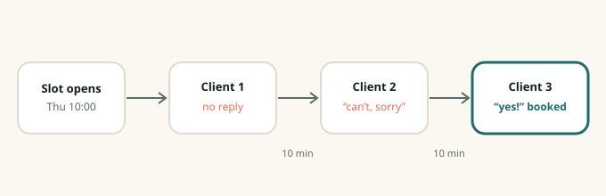

The obvious way to fill a cancelled slot is to text everyone on the waitlist at once and give it
to whoever replies first. We tried that in our first month. It filled slots quickly and made a
lot of people angry: the five who replied "yes!" thirty seconds too late felt worse than if
they'd never been asked.

So the waitlist engine works one person at a time. Here's how it decides who goes first.

## 1. Who can actually take it

Before ranking anyone, Corvel filters the waitlist down to people the slot works for:

- They asked for this provider, or said any provider is fine.
- The service they want fits in the slot, including buffers and processing time.
- The slot falls inside the days and times they told us work.
- They aren't already booked within the business's minimum rebooking interval.

On a typical day this cuts a waitlist of 40 down to three or four real candidates.

## 2. Who goes first

The remaining candidates are ranked by, roughly in this order:

1. **How long they've been waiting** for this provider or service.
2. **Whether they're mid-treatment.** A patient on a plan of care, or a colour client due for a
   touch-up, goes ahead of a first-time booking.
3. **Whether they've said yes before.** People who have accepted a waitlist offer in the past are
   much more likely to accept again.

Businesses can reorder these or pin specific clients to the top.

## 3. Ten minutes each

The first person gets a text with the slot and ten minutes to reply. If they say yes, the slot is
booked and nobody else hears about it. If they say no, or don't reply in time, the next person
gets the same offer. Salons usually shorten this to five minutes for same-day slots; clinics
usually leave it at ten.

In practice the first or second person takes it about 70% of the time, so most slots fill within
twenty minutes.

## What we got wrong at first

Our first version ranked people purely by how long they'd been waiting. It turned out that the
people who had been waiting longest were often the ones with the narrowest availability, and they
said no to most offers. Adding "has accepted before" as a signal made the biggest single
difference to fill rates.

## When not to fill

Sometimes the right answer is to leave a slot open. Corvel won't offer a slot closer to the start
time than your cut-off (two hours is the most common setting), and you can mark certain providers
or times as never-fill, for example the last slot of the day, or time a clinician uses for notes.
